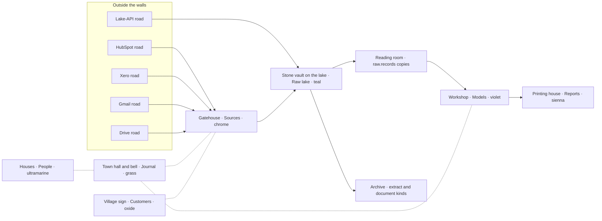

# The village: the Journal drawn as people at work

The village is a second way of reading one customer's Journal. Each operation the platform runs
for that customer appears as a character doing a job in a small village. Each place in the
village is a division of the book. The ledger stays the Journal's content and its default view.
The village is its picture, opened at `/tenants/:id/journal?view=village`. The decision and its
boundary are in [ADR 0115](../adr/0115-the-journal-can-be-read-as-a-village.md). This document
owns the cast, the layout, the visual language, and what each run makes a character do.

## Direction contract

THESIS: A reader who does not know the words "ingest", "transform" or "child build" can still
watch a customer's data arrive, be kept, and be made into something. A refusal is visibly set
aside rather than lost.

OWN-WORLD: The book's own stock, inks and wheel, printed onto a diorama. No new palette, font or
easing is introduced. The models are KayKit (CC0), repainted to the tokens.

MOTION: Stop-motion at 10 frames per second (ADR 0014, ADR 0115). Everything that moves is
sampled on the frame and held between frames. Nothing interpolates between frames. Under reduced
motion each poll paints one settled frame.

TRUTH: Nothing moves without a run behind it. A character at rest claims nothing. The picture
may lag the data by one walk. The words beside it never lag.

## Visual language

| In the scene                          | Token                                                 | Why                                                      |
| ------------------------------------- | ----------------------------------------------------- | -------------------------------------------------------- |
| Ground, paths, walls                  | Bone `#efe9d9`, Page `#f7f3e7`, Leaf `#fbf8f0`        | The board the book lies on                               |
| Outlines of every model               | Ink `#16150f`, about one hairline at the default zoom | Rules, never shadows                                     |
| The three lit tones of a face         | The surface tone, then mixed toward Ink by two steps  | One raking light, stepped and not graded                 |
| A building's roof                     | Its division's hue, from the table below              | The Wheel Rule: the hue names the division, and opens it |
| Characters' clothes and props         | Bone, Leaf, Ink 2, Ink 3                              | A character is not a division and wears no hue           |
| Water                                 | Teal lifted toward Bone                               | The lake is the Raw lake's ground                        |
| Errata slip (refused, failed, lapsed) | Vermilion on Slip ground                              | The Vermilion Rule: only the slip                        |

There are no cast shadows, no fog, no bloom and no depth of field. The camera is orthographic and
isometric, and it is fixed: it does not orbit or zoom.

## Layout

One building per division, laid out along the path the data takes. Every road outside the walls
belongs to one of the customer's connections, from `connections.list`. A road whose grant has
lapsed is barred and carries the slip.

| Place                   | Division (hue)       | Pressing it opens    |
| ----------------------- | -------------------- | -------------------- |
| Gatehouse and its roads | Sources (chrome)     | `/tenants/:id`       |
| Town hall and its bell  | Journal (grass)      | the ledger view      |
| Stone vault on the lake | Raw lake (teal)      | `/lake`              |
| Workshop                | Models (violet)      | `/models`            |
| Printing house          | Reports (sienna)     | `/reports`           |
| Houses                  | People (ultramarine) | `/people`            |
| Village sign            | Customers (oxide)    | `/tenants/:id/about` |

The vault is the undercroft the product is named for. A crate laid in it never moves again
(create-only). The reading room beside it holds the copies (`raw.records`). The cover's film
already draws the same split (ADR 0063).

## The cast

Every character is one of the five free KayKit Adventurers, in Bone and Ink. Several runs at
once means several instances. The platform allows one running run per source and verb, so two
couriers can be on two roads at once, but never two on the same road.

| Operation (run)                                            | Character               | Model     | Where                     |
| ---------------------------------------------------------- | ----------------------- | --------- | ------------------------- |
| Schedule tick (`trigger = schedule`)                       | No one: the bell swings | prop      | Town hall                 |
| Ingest (`verb = ingest`)                                   | Courier                 | Ranger    | Its source's road → vault |
| Landing and load (inside the ingest run)                   | Vault keeper            | Rogue     | Vault, reading room       |
| Lake-API push (`trigger = lake-api`)                       | Courier with a handcart | Ranger    | Lake-API road → vault     |
| Extract, classify (`extract`, `semantic`, `semantic-init`) | Scribe                  | Mage      | Archive                   |
| Build (`transform`, `build`)                               | Artisan                 | Barbarian | Workshop benches          |
| dbt tests (`run_step.kind = test`)                         | Inspector               | Knight    | Workshop                  |

### What each run makes them do

Each row is one rule the derivation enforces. Its test pins it at the public seam.

| Evidence                                                 | What the village shows                                                                                    |
| -------------------------------------------------------- | --------------------------------------------------------------------------------------------------------- |
| `run_opened`, trigger `schedule`                         | The bell swings twice, then the run's character sets out                                                  |
| `run_opened`, trigger `manual`                           | The character sets out and the bell stays still. The slip says a person started it                        |
| `run_waiting`, `whole_read_waiting`, `whole_read_paused` | The character sits on the bench by the gate                                                               |
| `entity_started`                                         | The courier walks out along that source's road                                                            |
| `entity_not_granted`                                     | The courier finds the road barred and walks back. No slip: nothing was refused                            |
| `records_read`, `documents_read` (gauges)                | The courier carries crates back. The pile is a gauge and never a count                                    |
| `documents_landed`, `archive_members_landed`             | The keeper seals a crate into the vault. It stays there                                                   |
| a row in `ops.run_refusal` / `refused > 0`               | One crate set aside on the vault's step, wearing an errata slip                                           |
| `entity_done`                                            | The courier goes to the next road, or home                                                                |
| `documents_extracted`, a semantic run's progress         | The scribe reads at the archive desk and shelves                                                          |
| child run with `parent_run_id` = this ingest             | The courier hands a copy to an artisan at the reading room (the hand-off)                                 |
| transform/build running                                  | Artisans work at the benches                                                                              |
| `run_step` kind `model`                                  | A finished piece on a bench                                                                               |
| `run_step` kind `test`                                   | The inspector checks a bench. A failure tips an errata slip onto it                                       |
| `no_models`                                              | The artisan opens the workshop, finds no bench, goes home                                                 |
| `run_closed` ok                                          | The character walks home                                                                                  |
| `run_failed`                                             | The character stops where they are and an errata slip tips in. It stays until the next run of that source |
| `run_stopped` (a deploy's safe point, ADR 0051)          | The character walks home without a slip                                                                   |
| connection status `expired`                              | The source's road is barred with an errata slip, the lapsed mark                                          |

Runs that closed before the village opened are not replayed. The latest closed run of each
source leaves its trace: its sealed crates, and its slip if it failed.

## Words, focus and access

- The canvas is `aria-hidden` and draws no letters.
- Beside it, the **work list** names every running run in DOM text: who, where, the gauge's
  figure in mono, and the start time in `Asia/Singapore`. Each line opens `/journal/:runId`.
- A character under the pointer or in keyboard focus shows a **proof slip** in DOM text: the
  run id, its kind, its source, its counts, and when it started. The same keys as the ledger.
- Every name is a catalogue key, Vietnamese first. Proposed names:

| Key          | vi               | en           |
| ------------ | ---------------- | ------------ |
| village      | Làng             | Village      |
| courier      | Người vận chuyển | Courier      |
| vault keeper | Người giữ kho    | Vault keeper |
| scribe       | Người chép sổ    | Scribe       |
| artisan      | Thợ              | Artisan      |
| inspector    | Người kiểm định  | Inspector    |

## Live data

The village reads what the Journal reads, with the reader's own session:

- `runs.list`, the first page, every 5 s while anything is running, and every 15 s otherwise
  while the village is on screen, so a scheduled run that starts is noticed.
- `runs.get` and `runs.events` for each running run, at the Journal's rates (5 s and 1 s).
- `connections.list` for the roads.

There is no push channel (ADR 0021).

## Budgets

- `three` and its glTF loader are in the village chunk only. Nothing else in the app imports
  them.
- The vendored models total 2 MB or less, compressed, and are loaded only when the view opens.
- The whole scene has 60,000 triangles or fewer. It draws at most 10 times a second, never while
  the tab is hidden or the canvas is off screen, and at a device pixel ratio of 2 or less.
- The renderer and every geometry are disposed when the view closes.

## Assets

The source is KayKit, by Kay Lousberg, CC0: Adventurers (the free five characters), Character
Animations (the clips for the medium rig), and Medieval Hexagon (tiles, buildings, props).

The packs are downloaded from itch.io by hand, because they have no other distribution, and are
kept outside the repo. A script run by `task` selects the subset, repaints the shared gradient
atlas to the tokens above, compresses it, and writes it to `apps/ui/src/assets/village/`. Only
that output is committed, beside `LICENSE.txt` (CC0) and `PROVENANCE.md` (the pack, its version,
the files taken, and what was changed).

## Phases

1. This document and ADR 0115.
2. The scene: the lazy chunk, the asset pipeline, the repainted village standing still, the
   stepped clock, reduced motion, and the view toggle.
3. The characters: the rig, the clips played in stop-motion, walking the road graph, and the
   pure script model.
4. One operation at a time:
   - ingest, with landing and refusals
   - build, with tests
   - extract and classify, the lake-API road, and the bell
5. Connected: the hand-off along `parent_run_id`, pressing characters and buildings, the work
   list and proof slips, visual-regression baselines, and a performance pass.

## Open questions

- **When `run_step` rows are written.** If they arrive only when dbt finishes, a build shows
  artisans working and its pieces land together at the end. Verify in phase 4.
- **Whether headless Chromium paints WebGL the same way twice.** This decides whether the
  visual-regression tier can cover the canvas (ADR 0115).
- **The atlas repaint.** It is either a new palette atlas mapped swatch by swatch, or a flat
  material per mesh. Decide in phase 2 against the real atlas.
