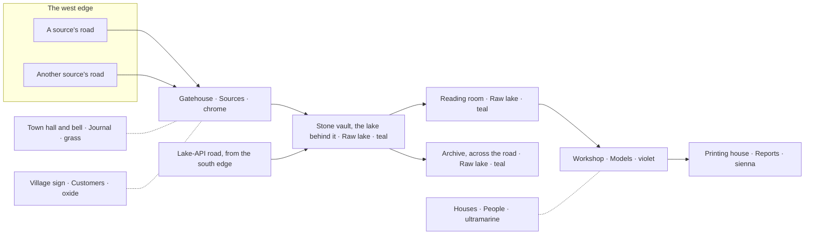

# The village: the Journal drawn as people at work

The village is a second way of reading one customer's Journal, opened at
`/tenants/:id/journal?view=village`. Each operation the platform runs for that customer appears
as a character doing a job in a small village, and each building in it stands for a division of
the book. The ledger stays the Journal's content and its default view; the village is the
ledger's picture. The decision and its boundary are in
[ADR 0116](../adr/0116-the-journal-can-be-read-as-a-village.md), and
[ADR 0117](../adr/0117-the-village-is-an-overview-and-replaces-no-drawing.md) keeps it to that:
an overview of the Journal, never a replacement for another drawing. This document owns the
cast, the layout, the visual language, and what each run makes a character do.

## Direction contract

THESIS: A reader who does not know the words "ingest", "transform" or "child build" can still
watch a customer's data arrive, be kept, and be made into something. A refusal is visibly set
aside rather than lost.

OWN-WORLD: The book's own stock, inks and wheel, printed onto a diorama. No new palette, font or
easing is introduced. The models are KayKit (CC0), repainted to the tokens.

MOTION: Stop-motion at 10 frames per second (ADR 0014, ADR 0116). Everything that moves is
sampled on the frame and held between frames, and the clips are keyed that way when they are
built. Nothing interpolates between frames. Under reduced motion each poll paints one settled
frame.

TRUTH: Nothing moves without a run behind it. A character at rest claims nothing. The picture
may lag the data by one walk; the words beside it never lag.

## Visual language

| In the scene                          | Ink                                                    | Why                                                       |
| ------------------------------------- | ------------------------------------------------------ | --------------------------------------------------------- |
| Every surface of every model          | Its family's design-system ramp, read at its lightness | The models keep KayKit's drawing in the system's own inks |
| Fields and trees                      | Along Grass                                            | A green is printed in Grass                               |
| Timber, leather, skin, sand           | Along Sienna                                           | An earth is printed in Sienna                             |
| Stone and grey cloth                  | Along Bone and Ink                                     | A grey is printed in the stock and the ink                |
| Water                                 | Along Teal, lifted, a little glossy                    | The lake is the Raw lake's ground                         |
| Roads                                 | Page `#f7f3e7`                                         | The paths are the page showing through                    |
| Outlines of every model               | Ink `#16150f`, finer on a character                    | The print's line                                          |
| Light                                 | A warm key from the north-west, a sky-and-grass fill   | A model on a desk under a lamp                            |
| Shadows                               | Soft, on the board and on the page beneath it          | An object on the page casts one; a sheet does not         |
| A building's roof and flag            | Its division's canonical hue, and only there           | The Wheel Rule: the hue names the division, and opens it  |
| Errata slip (failed, refused, lapsed) | Vermilion rules on Slip ground                         | The Vermilion Rule: only the slip                         |

The frame is photographed like a crafted miniature (`lib/village/look.ts`): ambient occlusion in
every crease, a tilt-shift band of focus through the middle of the village, and the page's grain
and a lamp's falloff toward the corners laid over everything. There is no fog and no bloom. The
camera is orthographic and fixed, looking from the south: it does not orbit or zoom.

Weather and machinery move on their own (`lib/village/ambience.ts`): clouds whose shadows drift
across the board, two small clouds at the back, the windmill's sails, the watermill's wheel at
the lake's east shore, and a flag in each division's hue beside its building. None of it is a
character, and none of it claims anything about a run. Under reduced motion it holds still.

How the repaint works: the asset script replaces each vertex's UV with the atlas cell KayKit
painted it from (`_CELL`) and how far down that cell's gradient (`_SHADE`), and records the
colours at each cell's two ends (`atlas.json`). The browser reads each vertex's source colour off
that gradient, finds its family by hue (a grey, a green, a blue, an earth…) and paints it that
family's ramp read at its lightness, between the two steps either side (`lib/village/palette.ts`).
The ramps are the design system's own, and `village.test.ts` holds them equal to `design.json`,
holds that every vertex lies along one of them, never in vermilion or a division's canonical
hue, and that only a building's team cells take its roof's hue.

## Layout

One building per division, laid out left to right along the path the data takes
(`lib/village/layout.ts`; the roads and the way along them are `lib/village/roads.ts`). Every
road at the west edge belongs to one of the customer's connections, from `connections.list`, in
up to five slots; a sixth source shares the fifth road. A disconnected source has no road. A road
whose grant has lapsed is barred, and the barrier carries a slip.

| Place                   | Division (hue)       | Pressing it opens    |
| ----------------------- | -------------------- | -------------------- |
| Gatehouse and its roads | Sources (chrome)     | `/tenants/:id`       |
| Village sign            | Customers (oxide)    | `/tenants/:id/about` |
| Town hall and its bell  | Journal (grass)      | the ledger view      |
| Stone vault             | Raw lake (teal)      | `/lake`              |
| Reading room            | Raw lake (teal)      | `/lake`              |
| Archive                 | Raw lake (teal)      | `/lake`              |
| Workshop                | Models (violet)      | `/models`            |
| Printing house          | Reports (sienna)     | `/reports`           |
| Houses                  | People (ultramarine) | `/people`            |

The vault is the undercroft the product is named for. Its door faces the road and the lake lies
behind it. Crates laid by its door stay there (create-only). The reading room beside it stands
for the copies (`raw.records`), as the cover's film already draws the split (ADR 0063).

## The cast

Every character is one of the five free KayKit Adventurers, printed in the ramps like
everything else: the ranger's cloak in Grass, the mage's robe in Violet, the knight's plate in
Bone and Ink. Several runs at once
means several figures. The platform allows one running run per source and verb, so two couriers
can be on two roads at once, but never two on one road.

| Character    | Model     | At home                    | Works for                                      |
| ------------ | --------- | -------------------------- | ---------------------------------------------- |
| Courier      | Ranger    | By the gate, one per road  | `ingest` runs of its road's source             |
| Vault keeper | Rogue     | Beside the vault door      | Whatever a courier or a carter is bringing     |
| Scribe       | Mage      | By the archive             | `extract`, `semantic` and `semantic-init` runs |
| Artisan      | Barbarian | By the workshop            | `transform` and `build` runs                   |
| Inspector    | Knight    | By the workshop            | The newest closed build's tests                |
| Carter       | Ranger    | Comes up the lake-API road | `lake-api` runs, at most two at once           |
| (the bell)   | made      | Beside the town hall       | Runs with `trigger = schedule`                 |

### What each run makes them do

`lib/village/script.ts` derives the scene from the runs. Each row is one of its rules, and
`village.test.ts` pins the ones a reader could be misled by.

| Evidence                                                                                  | What the village shows                                                                          |
| ----------------------------------------------------------------------------------------- | ----------------------------------------------------------------------------------------------- |
| The source's newest ingest is running                                                     | The courier walks out to the road's edge, picks up a crate, carries it to the vault door, again |
| …and the last thing it said is `run_waiting`, `whole_read_waiting` or `whole_read_paused` | The courier sits by the gate                                                                    |
| …and the last thing it said is `entity_not_granted`                                       | The courier walks to the road's barrier and back, again. No slip: nothing was refused           |
| A courier is fetching or a carter is delivering                                           | The keeper lays what arrives, at the vault door                                                 |
| The source's newest ingest failed                                                         | The courier stands at home under a slip, until a newer run of that source                       |
| The source's newest ingest closed ok, and a running run names it as its parent            | The courier waves at the reading room: the hand-off to the build                                |
| The newest extract or semantic run is running, or failed                                  | The scribe reads at the archive desk, or stands under a slip                                    |
| The newest transform or build is running, or failed                                       | The artisan hammers at the workshop, or stands under a slip                                     |
| No build is running and the newest closed build had tests                                 | The inspector checks the bench, under a slip if a test failed                                   |
| A lake-API run is running, or the newest one failed                                       | A carter carries crates up the lake-API road to the vault, or stands under a slip               |
| A run with `trigger = schedule` opened in the last eight seconds                          | The bell swings two full swings                                                                 |
| The connection is `needs_reconnect`                                                       | The road is barred, and the barrier carries a slip                                              |
| The newest closed ingest of each source landed records                                    | Crates stacked by the vault: one per power of ten of the total, at most five                    |
| The newest closed ingest of a source refused a record                                     | One crate set aside by the vault, under a slip, per such source, at most four                   |
| The newest closed build's model steps succeeded                                           | Finished pieces across from the workshop: one per power of ten, at most five                    |

dbt reports its steps when it finishes, not as it goes, so a running build shows the artisan at
work and its pieces and its inspection appear together when it closes. Runs that closed before
the village opened are not replayed; only their traces stand.

## What the village does not draw

The village is a glanceable overview of one customer's Journal, and nothing else (ADR 0117). A
run's stage map, in the run's own leaf, and the models' lineage, in Models → Lineage, are
node-and-edge drawings a reader works with: they pan, zoom, drag, keep a minimap and are read
precisely. They stay on React Flow (ADR 0097, ADR 0100), and no village replaces them or any
other view.

## Words, focus and access

- The canvas is `aria-hidden` and draws no letters. Its frame is `aria-busy` until the models
  have loaded. Where there is no WebGL, or a model will not load, the frame says so in a sentence
  instead of showing an empty box.
- Beside it, the **work list** names every character in DOM text: who, whom they work for (a
  courier's account, or the run a worker is on), what they are doing, and when that run started,
  in `Asia/Singapore`. A character with a run links to `/journal/:runId`.
- Beneath that, the **buildings** list names each building and the division it opens, as links.
- Pointing at a figure or a building in the picture lights its row, with the same wash a hovered
  row takes (`data-lit`), and shows a card above it: the figure's role, what they are doing, for
  whom and since when, or the building's name and the division it opens. The card is DOM text
  over the canvas, never drawn into it; it follows a walking figure at ten frames a second, stays
  inside the frame, and is `aria-hidden`, because it repeats the row. Pressing goes where the row
  goes. A keyboard reader uses the rows.
- Every name is a catalogue key, Vietnamese first, under `journal.village` in `apps/ui/src/i18n`.

## Live data

The village reads what the Journal reads, with the reader's own session:

- `runs.list`, the first page, every 5 seconds while anything is running and every 15 seconds
  otherwise, so a scheduled run that starts is noticed.
- `runs.events` for each running run, every second.
- `runs.get` for the newest closed build, once, for its steps.
- `connections.list`, for the roads.

There is no push channel (ADR 0021).

## Budgets

- `three` and its glTF loader are in the village's chunk only. Nothing else in the app imports
  them.
- The models are about 1.3 MB together, meshopt-compressed (`set.glb` 0.5 MB, `folk.glb`
  0.59 MB, `clips.glb` 0.2 MB), and are fetched only when the view opens.
- The scene draws at most 10 times a second, never while the tab is hidden or the canvas is off
  screen. It renders at twice the screen's pixels or more (at most three times) and is
  downscaled, which keeps the outlines and faces crisp at the diorama's size. A character is about 7,500 triangles, so a busy
  morning of nine figures and the board is about 100,000, drawn twice for the outline.
- The renderer and every geometry are disposed when the view closes.

## Assets

The packs, what was taken from each, the licence and every change made are in
`apps/ui/src/assets/village/README.md`. In short: KayKit Adventurers 2.0, Character Animations
1.1 and Medieval Hexagon 1.0, the free tiers, by Kay Lousberg, CC0. They are downloaded from
itch.io, the only place they are distributed, unzipped outside the repo, and turned into the
committed files by `task build:village-assets KAYKIT_DIR=<the unzipped packs>`.

## Visual regression

`apps/ui/src/routes/Journal.vrt.test.tsx` keeps two pictures of the village on a busy morning
(1440 px in English, 390 px in Vietnamese). The tier forces reduced motion, so each is the
settled frame. The Playwright image's software WebGL paints it the same way on every run.
